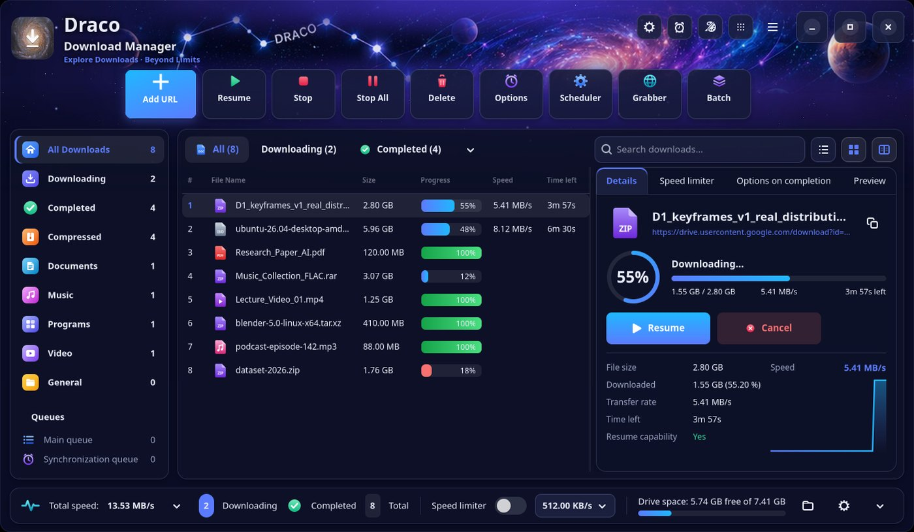
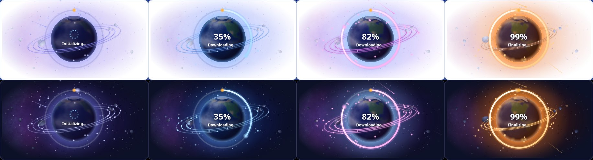
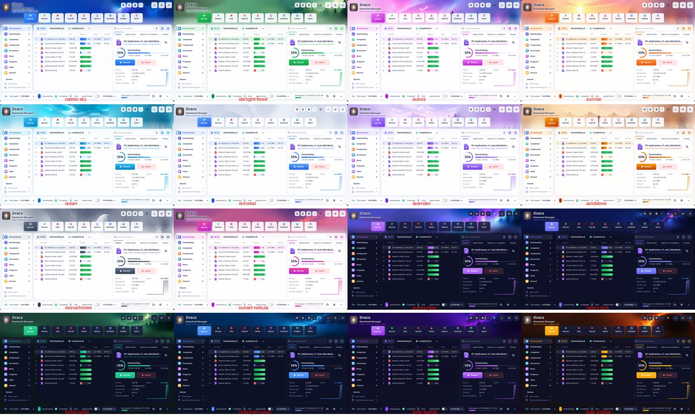
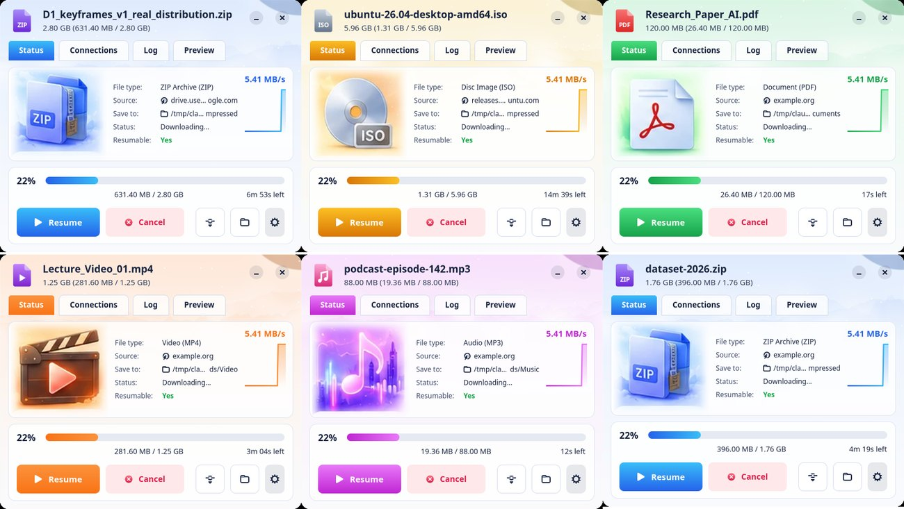
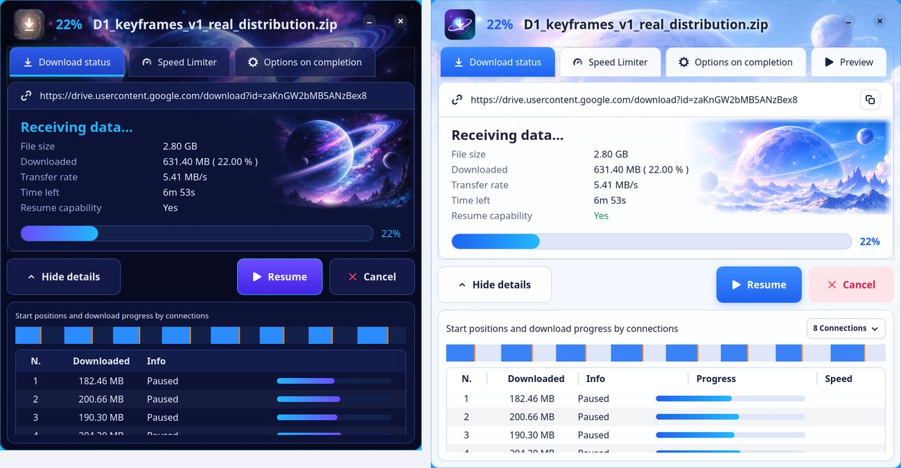
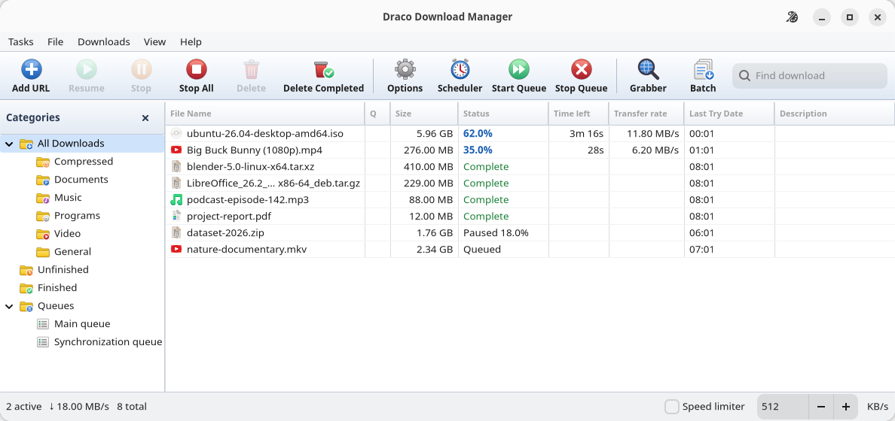

<div align="center">


# Draco Download Manager

**Fast, free download manager for Linux and Windows 11.**<br>
Multi-connection downloads, browser capture and streaming media. No accounts, no trials, no subscriptions.

[](https://github.com/Hafij-BGE/draco-dm/releases/latest)
[](https://github.com/Hafij-BGE/draco-dm/releases)
[](https://github.com/Hafij-BGE/draco-dm/actions/workflows/build.yml)
[](LICENSE)


[**Download**](https://github.com/Hafij-BGE/draco-dm/releases/latest) ·
[Features](#features) ·
[Browser extension](#browser-extension) ·
[Media downloads](#media-downloads-and-subtitles) ·
[Build from source](#build-from-source)



</div>

## Highlights

- ⚡ **Up to 32 connections per file** with dynamic segmentation: a connection that finishes early takes over half of the largest unfinished piece, so every connection stays busy until the end.
- ⏯️ **Pause, resume and crash recovery.** Every connection's position is saved, so downloads continue exactly where they stopped, even after a reboot.
- 🌐 **Browser capture** for Chrome, Edge, Brave, Opera, Vivaldi and Firefox, including snap and Flatpak browsers. Cookies and referrer are passed along, so logged-in downloads work.
- 🎬 **Media downloads** from the many sites supported by yt-dlp, plus HLS/DASH streams, with the size of every quality shown before you choose.
- 🗂️ **Queues, scheduler, categories, speed limiter**, site grabber, batch downloads and a clipboard watcher.
- ⏱️ **Starts while you choose.** The download begins in a temp folder the moment the save window opens, and moves to your folder when you click Start Download.
- 🎨 **31 themes**: 17 picture themes (11 light, 6 dark) with an illustrated header, a live planet that follows the selected download, and a progress window coloured by file type, plus 14 classic themes.
- 🪶 **Lightweight and private.** Python 3 + GTK 4/libadwaita, standard library only. No telemetry, no ads.

## Install

Get the file for your system from the [**latest release**](https://github.com/Hafij-BGE/draco-dm/releases/latest):

| System | File | Install |
|---|---|---|
| **Windows 11** | `DracoSetup-<version>.exe` | Double-click it. SmartScreen may warn because the app isn't code-signed: **More info → Run anyway**. |
| **Ubuntu, Debian, Mint, Pop!_OS** | `draco-dm_<version>_all.deb` | `sudo apt install ./draco-dm_*_all.deb` |
| **Fedora** | `draco-dm-<version>-1.noarch.rpm` | `sudo dnf install ./draco-dm-*.noarch.rpm` |
| **Arch, Manjaro, EndeavourOS** | `draco-dm-<version>-1-any.pkg.tar.zst` | `sudo pacman -U draco-dm-*-any.pkg.tar.zst` |
| **Any Linux (sandboxed, self-contained)** | `Draco-<version>-x86_64.flatpak` | `flatpak install --user Draco-*-x86_64.flatpak` |
| **Any Linux with GTK 4 (portable)** | `Draco-<version>-x86_64.AppImage` | `chmod +x Draco-*.AppImage`, then run it |
| **Anything else** | `draco-dm-<version>-linux.tar.gz` | Unpack, then `./install.sh` (no root needed) |

The Windows installer, AppImage and Flatpak include yt-dlp and ffmpeg. The `.deb` and `.rpm` install them from your distribution as recommended packages. On Arch, install them yourself: `sudo pacman -S yt-dlp ffmpeg`.

> [!NOTE]
> The Linux package is called `draco-dm` because Ubuntu already has an unrelated package named `draco`. The command is still `draco`.

## Features

### Downloading

| | |
|---|---|
| **Multi-connection engine** | Up to 32 connections per file with dynamic segmentation. Single-connection fallback for servers without range support. |
| **Resume anything** | Resume after pause, crash or reboot. Expired link? **Refresh download address** gives it a new link and keeps the data already downloaded. You can paste the link, or click *Wait for browser* and click it again in your browser. |
| **Progress window** | Size, speed, time left, resume support, a live map of the connections, per-connection details, its own speed limit and "on completion" actions. |
| **Queues and scheduler** | Several queues, each with its own number of simultaneous downloads. Start and stop times, weekdays, run once, retry failed files. When a queue finishes, Draco can exit, suspend, hibernate or shut down, with a 60-second cancel window. |
| **Speed limiter** | A global limit in the status bar, plus a per-download limit. |
| **Categories** | Compressed, Documents, Music, Programs, Video and General, each with its own folder and file types (editable in Options). |
| **Starts while you choose** | As soon as the File Info window opens, the file starts downloading into a `temp` folder, with a small progress bar in the window. **Start Download** moves it to the folder you chose; **Cancel** or closing the window deletes it. **Stop** or the **⋯** menu turns it off for this file, for a file type, or for good. Settings: **Options → Save To → Temp downloading**. Video pages wait for your quality choice. |
| **Your folder, every time** | The File Info window shows where the file will be saved, and **Last saved to** puts it in the same folder as your previous download with one click. Tick *Always save downloads to this folder* and every download goes there until you click **Reset to default**, in the window or in **Options → Save To**. |

### Capture and tools

| | |
|---|---|
| **Browser integration** | The extension hands downloads to Draco. Draco checks each link first; links that only work inside the browser (such as Google Drive) stay with the browser. |
| **Download all links** | From the browser's right-click menu, or by pasting or dropping several links onto Draco. |
| **Site grabber** | Crawls a site to a chosen depth and lists every file of the chosen types to pick from. |
| **Batch download** | Patterns like `https://site/img[001-150].jpg` or `part[a-f].rar`. |
| **Clipboard watcher** | Copy a link to a file type on the capture list and Draco offers to download it. |
| **Site logins** | HTTP Basic login per site pattern. |
| **Virus scan hook** | Run any command after a download, e.g. `clamscan --no-summary {file}`. |
| **Notifications** | One grouped desktop notification and an optional sound when downloads finish or fail. |
| **Import / export** | Import links from a text file; export the download list. |

### Runs quietly in the background

Closing the window keeps Draco running, with no taskbar entry, so browser downloads are still caught instantly. On Linux, a **Draco icon in the top bar** opens the window, adds a URL or quits Draco, and its tooltip shows how many downloads are running.

- Turn either behaviour off in **Options → General**.
- Turn on **Start Draco hidden at login** to always have it ready. Scheduled queues and snap/Flatpak browsers need this.
- On Ubuntu's GNOME the icon uses the built-in AppIndicator support. Other GNOME setups need the *AppIndicator and KStatusNotifierItem Support* extension. KDE, Cinnamon, XFCE and Budgie show it natively.

## Media downloads and subtitles

- **Media pages** on the 1000+ sites supported by [yt-dlp](https://github.com/yt-dlp/yt-dlp) are downloaded through it (see its list of supported sites).
- **⬇ Download this video** appears on the video player. Pick a quality and Draco shows the title, length and estimated size of every quality before it starts.
- **HLS (`.m3u8`)** streams download in parallel and are joined into one MP4, showing resolution, size and length. Encrypted or live streams and DASH (`.mpd`) go through ffmpeg.
- **Quick capture** (`Alt+Shift+D`) downloads the current page's video at the best quality with no dialog. The **Quick capture** switch in the extension popup starts every captured download straight away.
- **Subtitles:** tick **Include subtitles** and they are embedded in the video as a switchable track and also saved as `.srt`. **Subtitles only (.srt)** fetches just the text, in your browser's language with English as a fallback.

Draco runs at most two media downloads at once and retries automatically when a site is busy.

> Users are responsible for complying with the terms of service and copyright of the content they download. Draco is a general-purpose download manager and is not affiliated with any website.

## Browser extension

The extension shows a toolbar popup with the connection status, a capture on/off switch, the file types to capture and the media found on the current page.

**Chrome, Edge, Brave, Opera, Vivaldi:**

1. Draco places the extension in `Documents/Draco Browser Extension` on first start. It is also in every release as `draco-extension-chromium-<version>.zip`.
2. Open the browser's extensions page (`chrome://extensions`), turn on **Developer mode** and click **Load unpacked**.
3. Choose the `chrome` folder.

**Firefox:** use `draco-extension-firefox-<version>.zip`, or open `about:debugging#/runtime/this-firefox` and load `manifest.json` as a temporary add-on. Regular Firefox removes temporary add-ons on restart. To keep it, use Developer Edition or ESR with `xpinstall.signatures.required=false`.

**Snap and Flatpak browsers** (Ubuntu's Brave, Opera, Chromium and Firefox) can't start programs through native messaging. Click **Connect to Draco** in the extension popup and press **Allow** in Draco. This pairs the browser with Draco over `127.0.0.1` using a secret token, and web pages can't use the connection. Keep **Start Draco hidden at login** on, because a sandboxed browser can't launch Draco itself.

After an update, Draco refreshes its copy of the extension. Click **Reload** on the extension's card to pick it up.

## Themes

Switch instantly under **View → Theme** or with the palette button.

**Picture themes:**
- **Light:** Cosmic Sky, Starlight Forest, Aurora, Sunrise, Ocean, Minimal, Lavender, Sandstone, Monochrome, Sunset Nebula and Aurora Light.
- **Dark:** Galaxy Explorer, Aurora Glow, Forest Night, Midnight Ocean, Royal Purple and Solar Eclipse.

Each one has an illustrated header that fades into the window, white or dark tool tiles, a coloured sidebar, a download list with a details pane (progress ring, speed graph) and a status bar with the speed limiter and drive space.

**Live planet in the details pane.** Below the details, a planet follows the selected download through five stages with its real progress: *Initializing*, *Downloading*, *High speed* (from 70 %), *Finalizing* (from 95 % or while parts are joined) and *Completed*, with a calm look for paused and failed downloads. It fades into the white pane in light themes and into the dark pane in dark themes, runs on the GPU and stops when the window is hidden. **Options → General** turns it off or shows a still picture (**Reduce motion**).

<div align="center">

</div>

<div align="center">

</div>

In these themes every download gets its own **progress window coloured by file type**: ZIP, video, music, documents, programs, disc images, images, live streams and others. It has Status, Connections, Log and Preview tabs.

<div align="center">

</div>

Prefer one look for all downloads? Choose **Options → General → Progress window style → Classic** for the compact galaxy window: dark in dark themes, light in light themes.

<div align="center">

</div>

**Classic themes:** Follow desktop, Draco Classic, Retro Gray, Soft Light, Galaxy, Dark, Midnight Blue, Nightshade, Arctic Frost, Sand Light, Deep Teal, Forest, Sunset and High Contrast. They keep the menu-bar layout, and **View → Icon Style** changes their icons.

<div align="center">

</div>

To add your own theme, copy an entry in `BRIGHT` in `draco/gui/bright_style.py` (picture themes) or `THEMES` in `draco/gui/style.py` (classic themes). The theme pictures are made by `tools/make_theme_art.py`, the planet's by `tools/make_scene_art.py`.

## Command line

```bash
draco https://example.org/file.iso        # open the File Info dialog for a link
draco --now https://example.org/file.iso  # start right away
draco --background                        # start hidden (used for login autostart)
draco --status                            # is Draco running?
draco --selftest                          # check the installation
draco --install-browser                   # (re)register the browser native-messaging host
```

## Build from source

Run straight from a checkout:

```bash
sudo apt install python3-gi gir1.2-gtk-4.0 gir1.2-adw-1   # usually already present on GNOME
bin/draco
python3 -m unittest discover tests
```

Install for your user only (no root): run `./install.sh`. Add `--autostart` to start hidden at login, and run `./install.sh --uninstall` to remove it. Your settings (`~/.config/draco`) and download list (`~/.local/share/draco`) are kept.

Optional extras: `sudo apt install ffmpeg` for encrypted/live HLS and DASH, and `pipx install yt-dlp` for video sites.

Build the packages:

```bash
sh packaging/linux/build-deb.sh        # dist/draco-dm_<version>_all.deb
sh packaging/linux/build-rpm.sh        # needs rpmbuild
sh packaging/linux/build-arch.sh       # on Arch, needs makepkg
sh packaging/linux/build-appimage.sh   # downloads appimagetool, yt-dlp, ffmpeg into build-cache/
sh packaging/linux/build-tarball.sh
```

- **Flatpak:** the recipe is `packaging/flatpak/io.github.draco.DracoDM.yml`.
- **Windows:** see [packaging/windows/BUILD-WINDOWS.md](packaging/windows/BUILD-WINDOWS.md) for two `winget` installs and one build script.
- **CI:** [GitHub Actions](.github/workflows/build.yml) builds and self-tests every format. Pushing a `v*` tag publishes a release with notes from `docs/release-notes/<tag>.md`.

### Project layout

```
draco/engine.py      multi-connection HTTP/FTP engine, dynamic segmentation, rate limiter
draco/media.py       HLS downloader, ffmpeg and yt-dlp bridges
draco/manager.py     download list, queues, scheduler, persistence
draco/grabber.py     site crawler            draco/batch.py    batch pattern expansion
draco/ipc.py         single instance + CLI (Unix socket, or TCP with a token on Windows)
draco/bridge.py      loopback HTTP bridge for snap/Flatpak browsers (paired with a token)
draco/native.py      native-messaging host registration (Linux and Windows)
draco/osdeps.py      platform helpers: folders, autostart, opening files
draco/gui/           GTK 4 / libadwaita windows, dialogs, themes, dashboard layout and the top-bar icon
draco/art/           dashboard theme backgrounds and progress illustrations
native_host/         the stdio host the browser starts
extension/chrome/    browser extension (the Firefox variant is generated from it)
packaging/           .deb, .rpm, Arch, AppImage, Flatpak, tarball and Windows installer
```

To change the app icon, replace `data/draco-source.png` and run `python3 tools/make_icons.py`. The toolbar and category icons are SVG files in `draco/icons/`.

## Privacy and limits

- Draco makes no network requests of its own: no telemetry, no update checks, no ads.
- The download list can hold cookies, so it is stored with file mode `600`. Site logins in `settings.json` are also mode `600`, but not encrypted.
- On Wayland, the clipboard watcher only sees new links while Draco's window has focus. This is a desktop security rule, not a bug.
- FTP downloads use a single connection.
- DRM-protected streams (Netflix and similar) are not supported.

## License

Draco Download Manager © 2026 **Md Hafijur Rahman**, licensed under the [GPL-3.0](LICENSE).

This app was generated with AI. Developer support may not be available.

Third-party software bundled in some packages (ffmpeg, yt-dlp) and the libraries Draco uses are listed in [THIRD_PARTY_NOTICES.md](THIRD_PARTY_NOTICES.md), including links to the ffmpeg source code.

Users are responsible for complying with the terms of service and copyright of the content they download.
